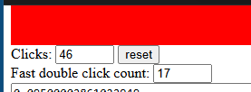
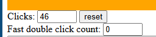

# AntiDouble

Vibe coded lightweight Windows utility to eliminate left mouse button double-click chatter caused by worn-out microswitches.

Intercepts low-level mouse events through a global hook, measures intervals using high-resolution performance counters (QPC), and drops chatter events below the defined threshold.

## Before and After

Before:



After:



## Usage

Run the executable:

```cmd
AntiDouble.exe
```

Optional custom debounce threshold in milliseconds (default is 80):

```cmd
AntiDouble.exe 70
```

Console output format:

```text
[+] double-click blocked (42ms)
```

## Build

Compile with MSVC:

```cmd
cl /O2 /EHsc /std:c++17 main.cpp user32.lib
```
